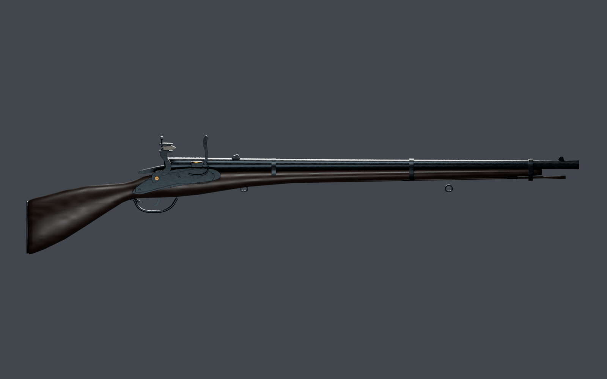
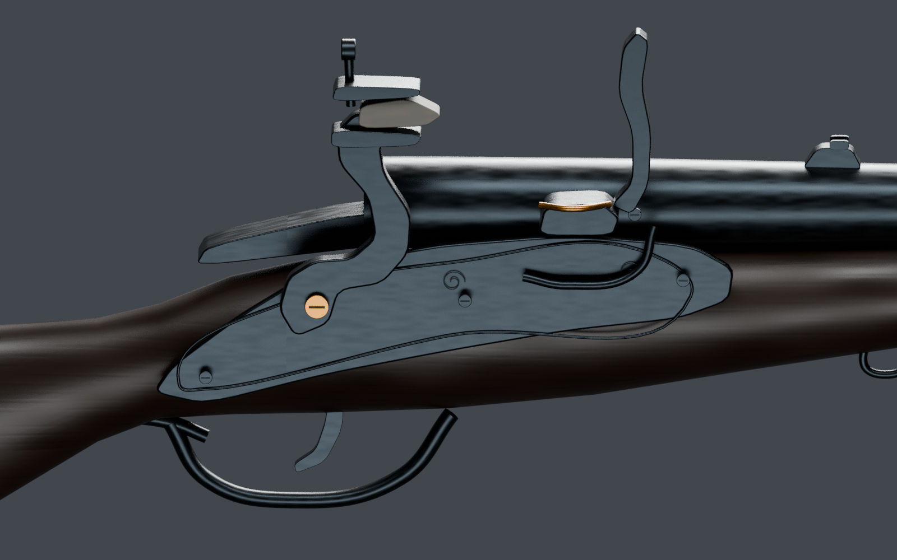
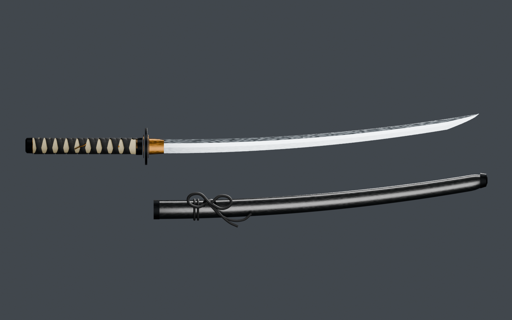
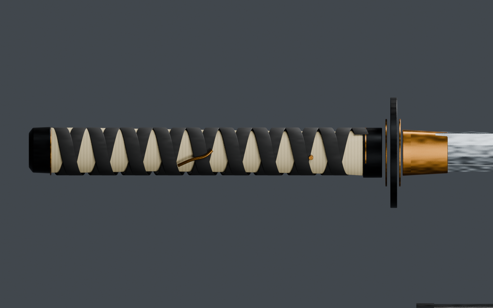

# Recovered weapon assets

Existing Blender weapon studies recovered from the interrupted modeling session. These remain unfinished studies with simplified lockwork, grip details, and surface treatment; they are not claimed to meet professional production quality.

[Download the complete ZIP](https://github.com/varneykirk55-collab/samurai-asset-library/raw/refs/heads/main/assets/Recovered_Weapon_Assets.zip)

The ZIP contains two independent asset folders with editable Blender sources, GLB exports, textures, original and freshly rendered previews, validation records, existing mechanism demonstration frames, and an assessment. Unzip before opening the Blender files.

- Archive size: 96,405,580 bytes.
- SHA-256: `2ec359940903709ad880aa428bcb0ee75827f6771e80c846ecebf08a1af670cc`.
- Both sources reopened in Blender 4.3.2; GLBs reimported and textures resolved.
- Saved geometry and material corrections were verified. Sources were unchanged during recovery.
- Recovery added no modeling or animation.

See [the assessment](ASSESSMENT.md) for dimensions, materials, export settings, and limitations.

## Firearm

## Katana and scabbard

